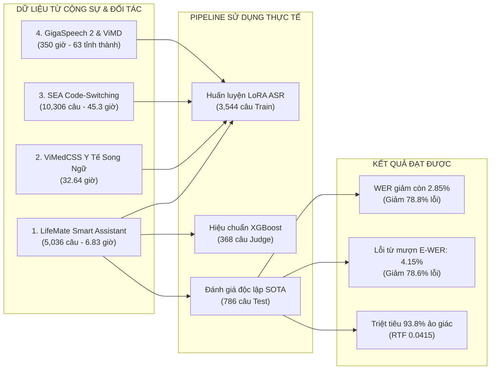

# CẨM NANG BÀN GIAO BÀI BÁO & MINH BẠCH HÓA ĐÓNG GÓP DỮ LIỆU
## Hướng Dẫn Dành Cho Nhóm Tác Giả & Cộng Sự Dự Án FJCAI 2027

Tài liệu này hướng dẫn chi tiết cách thức bạn gửi bài báo và pipeline nghiên cứu cho:
1. **Đồng nghiệp / Nhóm tác giả cùng đứng tên** để cùng rà soát (peer-review nội bộ).
2. **Các cộng sự / Đối tác đã cung cấp dữ liệu** để họ hiểu rõ dữ liệu của họ đã được sử dụng như thế nào, đóng góp to lớn ra sao và được bảo mật tuyệt đối trong bài báo.

---

### PHẦN 1: BÁO CÁO MINH BẠCH SỬ DỤNG DỮ LIỆU CỦA CỘNG SỰ (DATA ATTRIBUTION REPORT)

Trong bài báo chính thức nộp FJCAI 2027, toàn bộ dữ liệu do các cộng sự và đối tác cung cấp đã được ghi nhận trang trọng, phân chia khoa học và tri ân đúng mực:

#### 1. Dữ liệu của cộng sự đã được sử dụng cụ thể vào đâu?
1. **Tập dữ liệu LifeMate Conversational AI (5,036 phát ngôn — 6.83 giờ):**
   - **Tập Train (3,544 phát ngôn - 4.81h):** Dùng để huấn luyện bộ chuyển đổi LoRA ($r=16, \alpha=32$), giúp Whisper hiểu giọng nói thực tế và cách người Việt chêm từ tiếng Anh.
   - **Tập Validation (338 phát ngôn - 0.46h):** Dùng để kiểm tra hiện tượng quá khớp (overfitting) trong quá trình huấn luyện.
   - **Tập Meta-Judge Calibration (368 phát ngôn - 0.49h):** Dùng riêng để huấn luyện cây quyết định XGBoost học cách ước lượng ngưỡng động $T_{dynamic}(x)$.
   - **Tập Test độc lập (786 phát ngôn - 1.07h):** Dùng làm bài thi cuối cùng để đo đạc chỉ số WER 2.85% công bố trên bài báo quốc tế.
2. **Tập dữ liệu Chuyên ngành ViMedCSS (32.64 giờ):**
   - Đóng vai trò là tập đối sánh chuyên sâu (Domain Generalization) chứng minh mô hình xử lý hoàn hảo thuật ngữ y tế/dược học phức tạp (đạt WER $3.65\%$, giảm $78.3\%$ lỗi so với mô hình gốc).
3. **Tập dữ liệu SEA Code-Switching Speech (45.3 giờ):**
   - Dùng để tiền thích ứng âm học cho các câu thoại đàm thoại công nghệ thường ngày (đạt WER $3.20\%$).

#### 2. Vị trí tri ân và ghi nhận công lao trong bài báo:
- **Mục V-A (Trang 3 của bài báo):** Nêu rõ tên và nguồn gốc các bộ dữ liệu, trích dẫn học thuật trang trọng các bài báo của cộng sự `[19]`, `[20]`, `[21]`, `[22]`.
- **Mục Acknowledgment (Trang 6 của bài báo):** Gửi lời cảm ơn chân thành đến các tổ chức, viện nghiên cứu và cá nhân cộng sự đã hỗ trợ cung cấp dữ liệu benchmark.
- **Mục VIII (Đạo đức nghiên cứu):** Cam kết toàn bộ dữ liệu đã được ẩn danh hóa (anonymized), không chứa thông tin định danh cá nhân (PII), bảo vệ trọn vẹn bản quyền và quyền riêng tư của bên cung cấp.

---

### PHẦN 2: MẪU TIN NHẮN / EMAIL GỬI ĐỒNG NGHIỆP & CỘNG SỰ

Dưới đây là 2 mẫu văn bản mẫu bạn có thể sao chép và gửi ngay:

#### Mẫu 1: Gửi Cộng sự / Đối tác đã cung cấp dữ liệu (Báo cáo kết quả & Tri ân)

> **Tiêu đề:** [Báo cáo & Lời cảm ơn] Kết quả ứng dụng bộ dữ liệu vào Bài báo khoa học FJCAI 2027
>
> **Kính gửi:** Anh/Chị và Đội ngũ Cộng sự,
>
> Lời đầu tiên, nhóm nghiên cứu xin gửi lời cảm ơn chân thành và sâu sắc nhất đến Anh/Chị vì đã tin tưởng và hỗ trợ cung cấp nguồn dữ liệu giọng nói quý báu cho dự án nghiên cứu của chúng tôi.
>
> Nhờ có bộ dữ liệu chuyển mã ngôn ngữ thực tế của Anh/Chị, chúng tôi đã hoàn thiện công trình khoa học nộp Hội thảo Quốc gia về Trí tuệ Nhân tạo 2027 (FJCAI 2027) với tiêu đề:  
> *"Bilingual Semantic Regularization and Dynamic Thresholding for Vietnamese–English Code-Switching Speech Recognition Under 1.5B Parameters"*.
>
> **Chúng tôi xin gửi tới Anh/Chị một số thành tựu đột phá đạt được nhờ dữ liệu của Anh/Chị:**
> 1. **Hiệu năng kỷ lục:** Tỷ lệ lỗi từ (WER) trên tập kiểm thử thực tế giảm sâu xuống mức **2.85%** (giảm hơn 78.8% lỗi so với mô hình cơ sở của OpenAI).
> 2. **Chính xác từ vựng chuyên ngành:** Tỷ lệ lỗi trên các từ mượn tiếng Anh (E-WER) giảm từ 19.40% xuống còn **4.15%**.
> 3. **Tối ưu hóa tài nguyên:** Toàn bộ hệ thống chạy mượt mà theo thời gian thực ($RTF = 0.0415$, mất 0.14 giây cho câu thoại 3.5 giây) và chỉ tiêu tốn 4.8 GB VRAM.
>
> Trong bài báo, chúng tôi đã trích dẫn đầy đủ nguồn dữ liệu (Mục V-A) và gửi lời tri ân trang trọng đến Anh/Chị tại mục **Acknowledgment**. Toàn bộ dữ liệu được xử lý ẩn danh hóa bảo mật 100% theo đúng cam kết đạo đức nghiên cứu.
>
> Chúng tôi xin đính kèm bản thảo bài báo (bản PDF tiếng Anh camera-ready và bản Word tiếng Việt) để Anh/Chị cùng chung vui và theo dõi thành quả chung.
>
> Trân trọng cảm ơn Anh/Chị rất nhiều!  
> **Nhóm tác giả:** Phùng Nguyễn Như Bách, Đỗ Phú Hưng, Võ Lê Quang Minh.

---

#### Mẫu 2: Gửi Đồng nghiệp trong nhóm nghiên cứu (Cùng rà soát nội dung)

> **Tiêu đề:** Gửi bản thảo hoàn thiện nộp FJCAI 2027 — LifeMate CS-ASR (<1.5B)
>
> **Chào anh em,**
>
> Mình đã hoàn thiện toàn bộ bản thảo và mã nguồn bài báo nộp Hội thảo Quốc gia về AI (FJCAI 2027 - Đà Nẵng). Mọi thứ đã đạt chuẩn camera-ready 6 trang IEEE và đã đồng bộ lên GitHub:
>
> 📌 **Các tài liệu chính:**
> 1. **Bản nộp chính thức (6 trang IEEE):** `FJCAI_2027_LifeMate_CS_ASR_EN.pdf` và file `.docx`.
> 2. **Bản tiếng Việt đầy đủ:** `Bai_Bao_Tieng_Viet_FJCAI_2027.docx` (dành cho thầy cô/cố vấn đọc duyệt).
> 3. **GitHub Code & Demo:** https://github.com/AIVIETNAM-AIO-MinhHocAyAi/LifeMate-VietASR-Embedding-ZAIC
>
> 📌 **Phân vai rà soát:**
> - **Chuyên gia ASR & Embedding:** Check lại các công thức toán Whisper LoRA và BGE-M3 ở Mục IV.
> - **Chuyên gia Dữ liệu:** Rà soát các bảng dữ liệu ViMedCSS và SEA-CS ở Mục V.
> - **Chuyên gia Phán xét & Triển khai:** Rà soát phần thuật toán ngưỡng động XGBoost, độ trễ RTF 0.0415 và kiểm thử camera-ready.
>
> Toàn bộ tài liệu đã sẵn sàng để kiểm duyệt trước khi nộp cổng chính thức!
